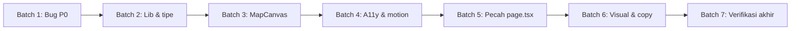

# Audit & Refactor Plan — AI NgaeBanten (Round 2)

Scope: semua kode di `app/`, `components/banten-map/`, `lib/`, `data/`, `test/` (± 6.900 baris). Audit sudah dilakukan (read-only). Dokumen ini berisi temuan + rencana eksekusi. **Belum ada kode yang diubah.**

## Peran tiap skill

| Skill | Dipakai untuk |
|---|---|
| `ponytail-audit` | Audit seluruh repo: bug, keamanan, beban, kode mati |
| `ponytail` | Aturan refactor: perubahan terkecil, hapus sebelum menambah |
| `ponytail-review` | Review tiap batch setelah selesai |
| `web-design-guidelines` | A11y, fokus, keyboard, motion, form |
| `micro-interactions` | Transisi, feedback, animasi peta |
| `anti-slop-design` + `design-taste-frontend` | Hilangkan pola visual generik AI |
| `humanizer` | Rapikan copy Bahasa Indonesia |
| `caveman` | Gaya laporan: ringkas, fakta teknis utuh (bukan untuk copy UI) |

---

## Temuan audit

### P0 — Bug / perilaku salah

| # | File | Masalah | Dampak |
|---|---|---|---|
| A1 | [MapCanvas.tsx](file:///d:/Project/AI%20NgaeBanten/components/banten-map/MapCanvas.tsx) | Effect marker memanggil `clearLayers()` dan membuat ulang **semua** marker setiap kali `selectedVendorId` berubah | Cluster berkedip/terbuka ulang tiap klik; O(n) rebuild |
| A2 | MapCanvas + [BantenMap.tsx](file:///d:/Project/AI%20NgaeBanten/components/banten-map/BantenMap.tsx#L115-L122) | Klik marker memanggil `map.flyTo()` **dan** `handleSelectVendor` men-set `flyToLocation` → dua animasi flyTo bertabrakan | Gerakan peta tersendat |
| A3 | [repository.ts](file:///d:/Project/AI%20NgaeBanten/lib/vendors/repository.ts#L179-L184) | Comparator jarak: jika `a` dan `b` sama-sama `undefined` → return `1` (tidak konsisten) | Urutan tidak stabil antar browser |
| A4 | [BantenMap.tsx](file:///d:/Project/AI%20NgaeBanten/components/banten-map/BantenMap.tsx#L93-L112) | Badge hitungan kategori mengabaikan filter `onlyVerified`, padahal daftar memakainya | Angka badge ≠ jumlah kartu |
| A5 | [StoreDetailSheet.tsx](file:///d:/Project/AI%20NgaeBanten/components/banten-map/StoreDetailSheet.tsx#L52-L57) | `tel:` memakai nomor mentah; `clipboard.writeText` tidak di-`await`, gagal diam-diam | Link telepon bisa rusak; tidak ada feedback |

### P1 — Keterawatan & keamanan

| # | File | Masalah |
|---|---|---|
| B1 | [page.tsx](file:///d:/Project/AI%20NgaeBanten/app/page.tsx) | 937 baris, 13 `useState`, semua section dalam satu komponen |
| B2 | page.tsx L9–117 | Komponen `Icon` switch buatan sendiri (110 baris) padahal `lucide-react` sudah terpasang |
| B3 | page.tsx L828–920 + `data/cities.ts` | Section "peta" lama (iframe OSM + link Google Maps) sekarang duplikat fitur `/peta-toko-banten` |
| B4 | page.tsx, repository.ts, BantenMap.tsx | Kunci `localStorage` ditulis sebagai string literal di 3 file |
| B5 | MapCanvas.tsx | `require()` di modul ESM, 7× `any`, plugin diregister di dalam effect |
| B6 | repository.ts L85–93 | `getFavoriteVendorIds` tidak memvalidasi hasil `JSON.parse` adalah `string[]` |
| B7 | BantenMap.tsx L56 / StoreSearch L87 / repository L149 | `any[]` / `as any` → bisa diganti tipe nyata |
| B8 | BantenMap.tsx L161 | `setTimeout` pesan error lokasi tidak dibersihkan saat unmount |
| B9 | [route.ts](file:///d:/Project/AI%20NgaeBanten/app/api/analyze/route.ts#L84) | Rate limit memercayai `x-forwarded-for` mentah (bisa dipalsukan); in-memory per instance. Cukup untuk MVP — didokumentasikan, tidak diganti |

### P1 — Aksesibilitas & interaksi (`web-design-guidelines`, `micro-interactions`)

| # | Masalah |
|---|---|
| C1 | `StoreDetailSheet` & `DataImportModal`: tidak ada tutup via `Escape`, fokus tidak dipindah ke dialog / dikembalikan ke pemicu |
| C2 | `map.flyTo` adalah animasi JS → tidak tersentuh aturan CSS `prefers-reduced-motion` di globals.css |
| C3 | 7× `transition: all` di map.css → ganti properti eksplisit |
| C4 | Kartu toko: area klik vs tombol bookmark bersarang; perlu cek role/keyboard (`Enter`/`Space`) |
| C5 | Pesan error lokasi muncul tanpa `role="status"`/`aria-live` (perlu verifikasi) |

### P2 — Visual & copy (`anti-slop-design`, `design-taste-frontend`, `humanizer`)

| # | Masalah |
|---|---|
| D1 | Ikon `Sparkles` dipakai 10× di map (termasuk sebagai logo) → klise "AI magic"; ganti dengan mark bunga yang sudah ada di homepage |
| D2 | Ornamen `✦` di top strip homepage |
| D3 | map.css 1.548 baris dengan banyak `!important` dan override global `.leaflet-container` → scope ke `.banten-map-page-wrapper` |
| D4 | Audit copy ulang untuk komponen peta (dibuat setelah audit sebelumnya) |

### Tes

| # | Masalah |
|---|---|
| E1 | Tidak ada tes untuk comparator sort (A3), hitungan kategori (A4), validasi favorit (B6), normalisasi nomor telepon (A5) |
| E2 | Warning `MODULE_TYPELESS_PACKAGE_JSON` di setiap `npm test` |

---

## Rencana eksekusi (bertahap)

Tiap batch diakhiri: `npm run typecheck` → `npm test` → cek HTTP 200 → `ponytail-review` singkat. Jika batch gagal, berhenti dan lapor.

### Batch 1 — Bug P0 (lib, kecil, ada tes)
- A3: comparator jarak konsisten (keduanya `undefined` → 0).
- A4: hitungan kategori lewat `queryVendors` dengan filter aktif kecuali kategori.
- A5: helper `normalizePhone()` di `lib/vendors/` dipakai untuk `wa.me` dan `tel:`; clipboard `await` + feedback sukses/gagal.
- E1: tambah tes untuk ketiganya.

### Batch 2 — Lib & tipe
- B4: `lib/storage-keys.ts` berisi 3 kunci; semua pemakai impor dari sini.
- B6: validasi favorit `string[]`.
- B7: hapus `any` (`Ingredient[]`, `VendorSortBy`, type guard kategori).
- E2: tambah `"type": "module"` **hanya jika** build Next tetap lolos; jika tidak, biarkan.

### Batch 3 — MapCanvas
- A1: marker dibuat sekali per perubahan `vendors`; perubahan seleksi hanya `setIcon()` + `setZIndexOffset()` pada 2 marker (lama & baru).
- A2: satu sumber flyTo (lewat `flyToLocation`); hapus flyTo di handler marker.
- B5: `await import("leaflet.markercluster")` di effect, tipe dari `@types/leaflet.markercluster` jika ada; jika tidak, satu interface lokal kecil.
- `onSelectVendor` disimpan di ref agar effect init tidak bergantung closure lama.

### Batch 4 — Aksesibilitas & motion
- C1: hook kecil `useDialog(onClose)` → Escape, fokus awal, kembalikan fokus. Dipakai di detail sheet & modal.
- C2: cek `matchMedia('(prefers-reduced-motion: reduce)')` → `setView` tanpa animasi.
- C3: ganti `transition: all`.
- C4/C5: perbaiki semantik kartu dan live region.

### Batch 5 — Pecah page.tsx (struktur, tanpa ubah perilaku)
- B2: ganti `Icon` dengan `lucide-react`.
- B3: ganti section peta lama dengan kartu CTA ringkas ke `/peta-toko-banten`; hapus `data/cities.ts` jika tak dipakai lagi. **Ini menghapus fitur iframe — lihat pertanyaan di bawah.**
- B1: pecah jadi `components/home/` → `SiteHeader`, `Hero`, `HowItWorks`, `Planner` (input + checklist + budget), `MapCta`, `SiteFooter`. Hook `usePlanStorage()` untuk load/save localStorage.
- Target: `app/page.tsx` < 80 baris.

### Batch 6 — Visual & copy
- D1/D2: ganti `Sparkles` & `✦` dengan mark bunga / tanpa ornamen.
- D3: scope selektor Leaflet ke wrapper peta, kurangi `!important` yang tidak perlu (tanpa redesign).
- D4: pass `humanizer` pada semua teks di `components/banten-map/` dan `components/home/`.

### Batch 7 — Verifikasi akhir
- `npm run typecheck`, `npm test`, `npm run build` (dengan dev server dihentikan dulu untuk mencegah error `./897.js` lagi), restart dev, cek `/` dan `/peta-toko-banten`.
- Tulis `docs/REFACTOR_REPORT.md`: sebelum/sesudah (jumlah baris, `any`, `!important`), daftar perubahan per batch.

## Di luar scope
- Ganti rate limiter ke Redis/Upstash (B9) — hanya dicatat.
- Routing jalan sungguhan (OSRM), Supabase, redesign visual besar.
- Tes komponen React (belum ada infrastruktur; tidak menambah dependency).

> [!IMPORTANT]
> Butuh keputusan sebelum Batch 5: **hapus section peta lama di homepage (iframe OSM + pilihan kota) dan ganti dengan CTA ke `/peta-toko-banten`?** Rekomendasi: ya — fiturnya sudah digantikan halaman peta baru.
